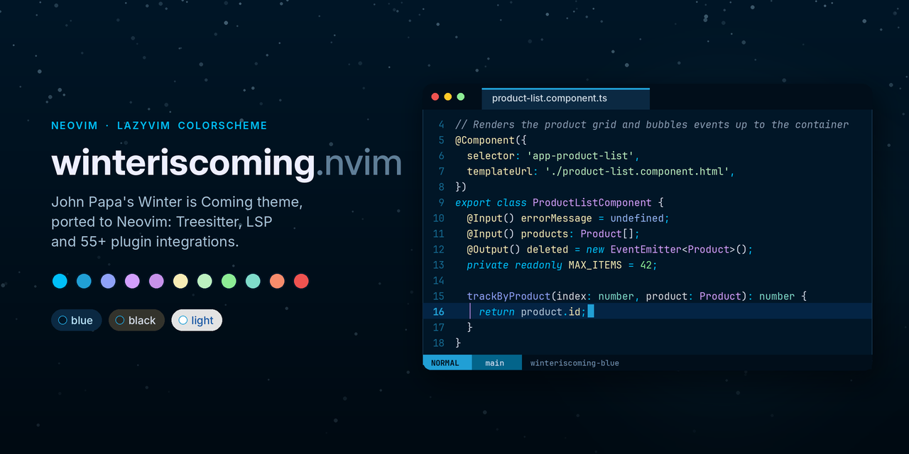
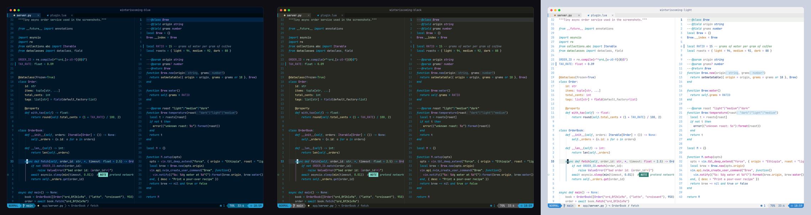
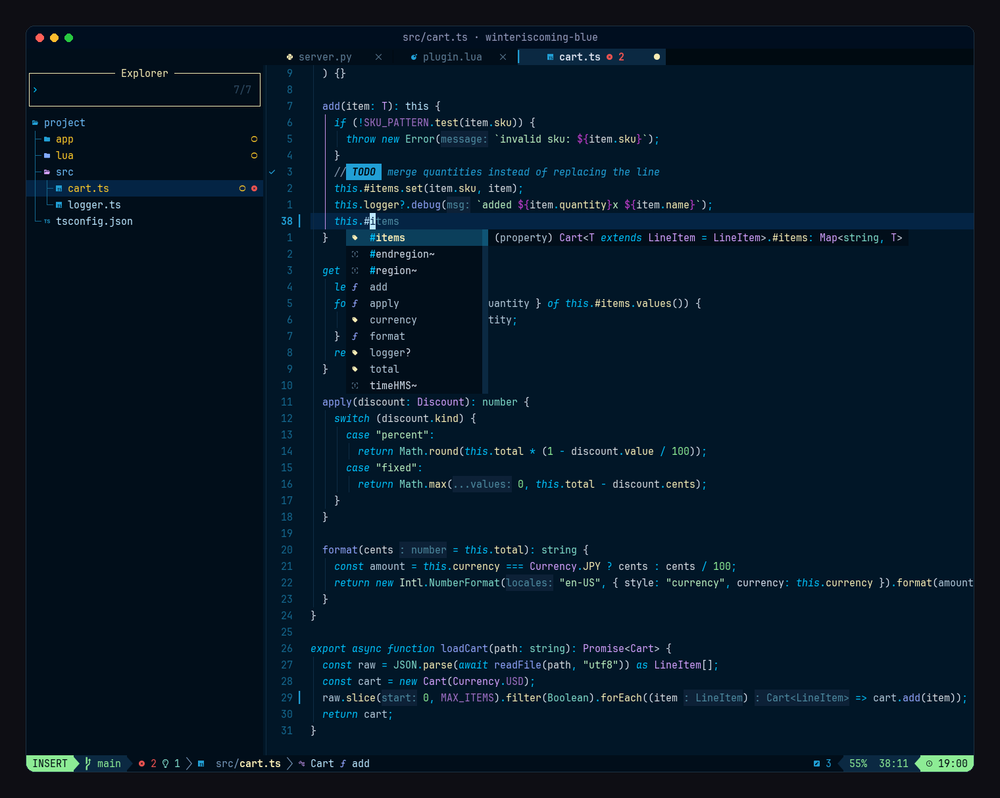
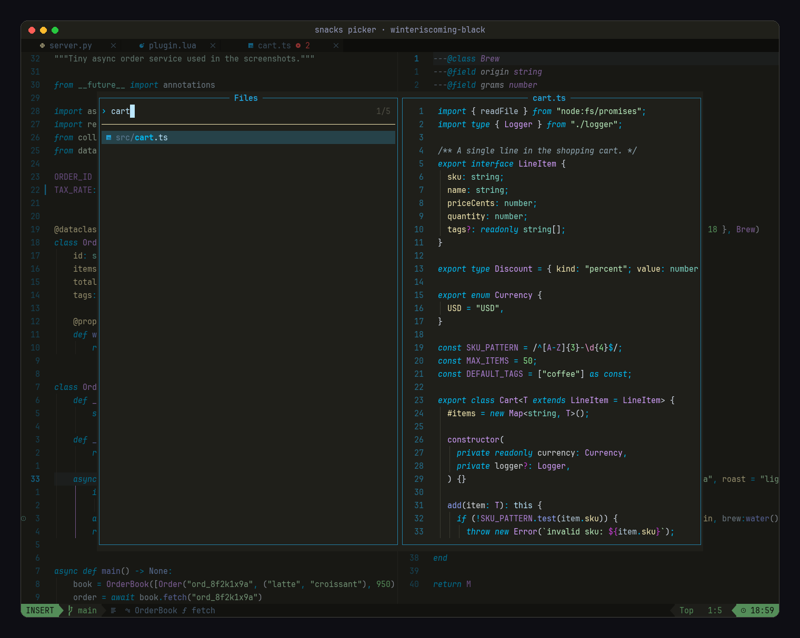
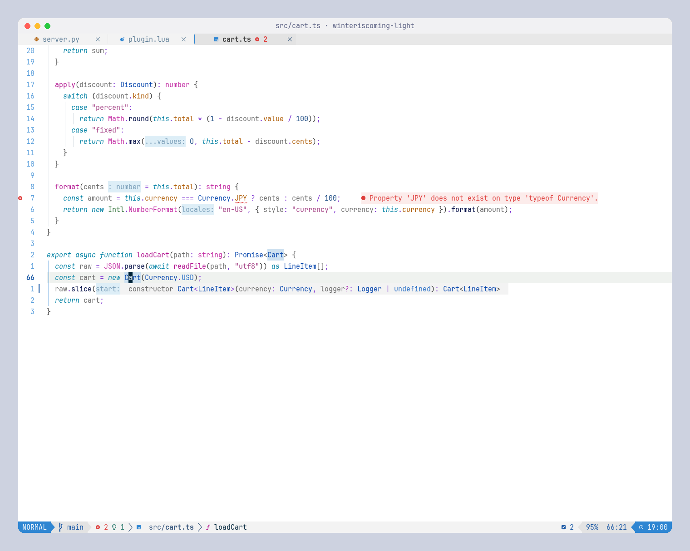
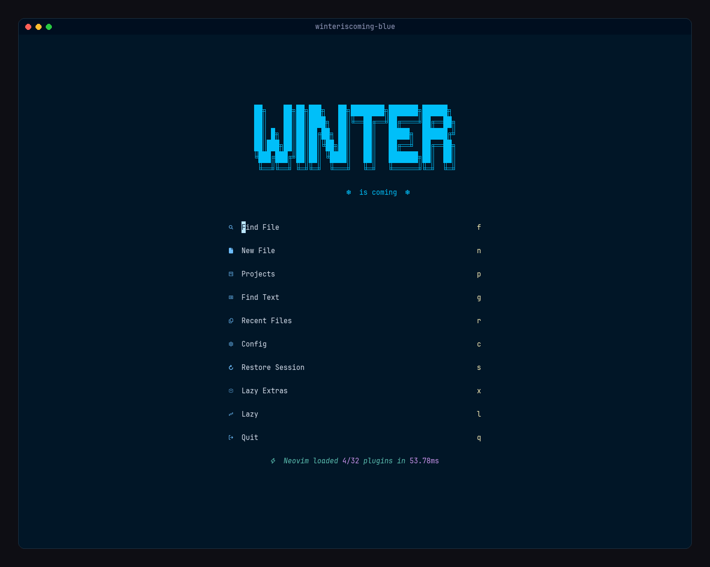
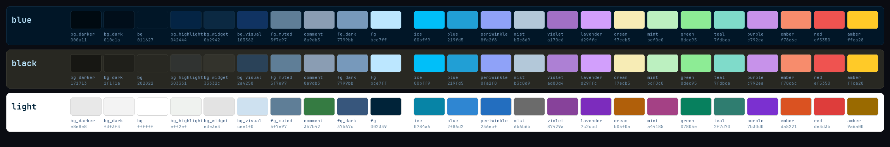

# ❄️ winteriscoming.nvim

[](https://github.com/bytebeast/winteriscoming.nvim/actions/workflows/ci.yml)
[](https://github.com/bytebeast/winteriscoming.nvim/tags)
[](https://neovim.io)
[](https://www.lazyvim.org)
[](https://www.lua.org)
[](LICENSE)
[](https://github.com/bytebeast/winteriscoming.nvim/stargazers)

A Neovim and LazyVim port of John Papa's
[Winter is Coming](https://github.com/johnpapa/vscode-winteriscoming) VS Code



## Styles



| Colorscheme            | Based on                      | Background                   |
| ---------------------- | ----------------------------- | ---------------------------- |
| `winteriscoming-blue`  | Winter is Coming (Dark Blue)  | `#011627` navy               |
| `winteriscoming-black` | Winter is Coming (Dark Black) | `#282822` charcoal           |
| `winteriscoming-light` | Winter is Coming (Light)      | `#ffffff`                    |
| `winteriscoming`       | follows `vim.o.background`    | your `style` / `light_style` |

Comments and keywords are italic by default. The original theme also italicizes
functions, variables, properties and decorators; see [Italics](#italics) to turn
that back on.

## Screenshots

Real LazyVim sessions (vtsls and pyright for LSP, treesitter for everything
else).

|                                                                                      |                                                                         |
| ------------------------------------------------------------------------------------ | ----------------------------------------------------------------------- |
|                     |  |
| **Completion and explorer** · blue                                                   | **Picker** · black                                                      |
|  |    |
| **Diagnostics and hover** · light                                                    | **Dashboard** · blue                                                    |

## Install with LazyVim

Create `~/.config/nvim/lua/plugins/winteriscoming.lua`:

```lua
return {
  {
    "bytebeast/winteriscoming.nvim", -- or: dir = "~/code/winteriscoming.nvim"
    lazy = false,
    priority = 1000,
    opts = {},
  },
  {
    "LazyVim/LazyVim",
    opts = { colorscheme = "winteriscoming" }, -- or "winteriscoming-black", ...
  },
  {
    "akinsho/bufferline.nvim",
    opts = function(_, opts)
      -- bufferline builds its file icon colors from these
      opts.highlights = function()
        return require("winteriscoming.groups.bufferline").highlights()
      end
    end,
  },
}
```

LazyVim's lualine uses `theme = "auto"`, which picks up the bundled lualine
theme by itself. The bufferline gets the VS Code tab look (dark inactive tabs, a
lighter navy active tab with a winter-blue marker) by itself too, but bufferline
draws file icons from its own `highlights` option, so without the block above
the icons sit on a mismatched background. Integrations are enabled for exactly
the plugins lazy.nvim (or `vim.pack`) has installed, so there is nothing to
list. Full docs: `:h winteriscoming`; `:checkhealth winteriscoming` shows what
is active.

Without LazyVim:

```lua
require("winteriscoming").setup({ style = "blue" })
vim.cmd.colorscheme("winteriscoming")
```

### Customizing in LazyVim

Everything goes in `opts`. This example picks a style, changes a few options,
recolors through the palette, and overrides individual highlight groups:

```lua
return {
  {
    "bytebeast/winteriscoming.nvim",
    lazy = false,
    priority = 1000,
    opts = {
      style = "black", -- "blue", "black" or "light"
      transparent = true, -- let the terminal background show through
      styles = {
        functions = { italic = true }, -- add italics on top of comments + keywords
        sidebars = "transparent", -- neo-tree, trouble, help, ...
        floats = "transparent",
      },
      bright_line_numbers = true, -- every line number in winter blue, like VS Code

      -- palette and role overrides, applied before highlights are built
      on_colors = function(c)
        c.ice = "#38c6ff" -- keywords, operators, jump labels, picker matches
        c.syntax.string = "#c3f5c6" -- just strings
        c.syntax.func = "frost" -- point a role at another palette color
      end,

      -- individual highlight groups, applied last
      on_highlights = function(hl, c)
        hl.CursorLineNr = { fg = c.cream, bold = true }
        hl.WinSeparator = { fg = c.blue }
        hl["@variable.parameter"] = { fg = c.cream, italic = true }
        hl.SnacksPickerMatch = { fg = c.green, bold = true }
      end,
    },
  },
  {
    "LazyVim/LazyVim",
    opts = { colorscheme = "winteriscoming" }, -- follows `style` above
  },
}
```

`on_colors` changes colors at the source, so everything that uses them
follows (changing `ice` recolors every keyword). `on_highlights` is for
one-off tweaks to specific groups. The palette names are listed under
[Palette](#palette); `:Inspect` on any character shows which group colors it.
Restart Neovim after changing `opts`.

## Configuration

These are the defaults; pass only what you want to change.

```lua
require("winteriscoming").setup({
  style = "blue", -- "blue", "black" or "light"
  light_style = "light", -- used when 'background' is light
  transparent = false, -- don't set the editor background
  terminal_colors = true, -- colors for :terminal
  hide_inactive_statusline = false, -- inactive statuslines become a thin line
  italics = true, -- false drops every italic, comments and keywords included
  bold = true, -- false drops every bold attribute
  styles = {
    -- any attr-list accepted by nvim_set_hl
    comments = { italic = true },
    keywords = { italic = true },
    functions = {},
    variables = {},
    properties = {},
    attributes = {}, -- decorators, tag attributes
    parameters = {},
    types = {},
    strings = {},
    operators = {},
    virtual_text = {}, -- diagnostic virtual text
    inlay_hints = {},
    -- LSP semantic modifiers, stacked on the token's color
    mutable = {}, -- e.g. { underline = true } for Rust `mut`
    readonly = {}, -- e.g. { italic = true }
    statics = {}, -- e.g. { bold = true }
    globals = {}, -- e.g. { underdotted = true }
    sidebars = "dark", -- "dark", "transparent" or "normal"
    floats = "dark", -- "dark", "transparent" or "normal"
  },
  bright_line_numbers = false, -- true = every line number in winter blue, like VS Code
  faithful = false, -- true = exact VS Code colors instead of this port's adjustments
  dim_inactive = false, -- darken inactive windows
  contrast = "normal", -- "high" lifts every syntax color to WCAG AA, plus comments and line numbers
  subtle_comments = false, -- true, a fade from 0 to 1, or { fade = 0.7, docstrings = false }
  colorblind = false, -- "red-green" or "blue-yellow"
  saturation = 1, -- 0 (greys) to 1 (full color); contrast is kept
  accent = "blue", -- titles, badges, selected tab, float borders, normal mode
  rainbow = "vivid", -- rainbow delimiters and indent scopes: "vivid", "dimmed" or "mono"
  rainbow_variables = false, -- a color per local variable (needs LSP semantic tokens)
  diagnostics = {
    underline = "undercurl", -- "undercurl", "underline" or false
    virtual_text = "tinted", -- "tinted" or "plain"
  },
  inlay_hints = "tinted", -- "tinted" or "plain"
  borderless = false, -- pickers framed by shade instead of border lines
  bright_borders = false, -- float borders in the full accent color
  lualine_bold = false, -- bold mode section in lualine
  on_colors = function(colors) end,
  on_highlights = function(highlights, colors) end,
  cache = true,
  plugins = {
    all = nil, -- nil: everything, unless lazy.nvim or vim.pack is in use
    auto = true, -- with lazy.nvim or vim.pack, only plugins you have installed
    -- telescope = true, -- force an integration on or off
  },
})
```

Invalid values are reported once and replaced by their defaults.

### Accessibility and color options

These change derived colors only; the palette and its role mapping stay as they
are.

- `contrast = "high"` lifts every syntax color below WCAG AA (4.5:1) up to it,
  and brightens comments, line numbers, inlay hints and muted UI text. A few
  stock colors sit just under AA (light keywords at 4.3:1, `template` magenta
  at 4.4:1 on navy), so this is the switch for bright rooms and low vision.
- `colorblind` remaps git signs, diffs and diagnostics to colors that stay
  apart under a simulation of each deficiency (Machado et al. 2009), following
  GitHub's conventions: added and ok are blue, deleted and errors warm. Syntax
  colors are untouched.
- `subtle_comments` fades comments by contrast, so the same value looks the
  same in every style, and never below 1.6:1. A comment color you set in
  `on_colors` is left alone.
- `saturation` scales color in OKLab and restores each color's contrast, so
  `0.6` is calmer without getting harder to read. Git, diff and diagnostic
  colors keep at least 70% of theirs so they stay distinguishable.
- `accent` is one of `blue`, `sky`, `azure`, `periwinkle`, `teal`, `aqua`,
  `green`, `lime`, `cream`, `amber`, `coral`, `rose`, `pink`, `lavender` or
  `purple`; every choice besides the default keeps badge text at 4.5:1.
- `rainbow_variables` gives every local variable and parameter its own color
  from its name, as in JetBrains IDEs: 12 colors (6 with `colorblind`), all at
  AA on the cursorline.

### Italics

To match the VS Code theme exactly, with code italicized as well:

```lua
opts = {
  styles = {
    functions = { italic = true },
    variables = { italic = true },
    properties = { italic = true },
    attributes = { italic = true },
  },
}
```

### Adjusted colors and `faithful`

A few colors are tuned for a terminal, where the original relied on italics to
tell blues apart. `faithful = true` restores the exact VS Code values.

| Role                 | This port | VS Code            | Why                                               |
| -------------------- | --------- | ------------------ | ------------------------------------------------- |
| functions            | `#8fa2f8` | `#87aff4`          | was nearly identical to constants                 |
| variables            | `#b3c8d9` | `#a4ceee`          | greyer, so it separates from keywords             |
| constants            | `#a170c6` | `#82aaff`          | VS Code's own `constant` purple                   |
| comments             | `#8a9db3` | `#999999`          | cool grey-blue at the same contrast               |
| docstrings           | `#a3c7ba` | `#bcf0c0` (string) | long docstrings read as prose, not a wall of mint |
| Dark Black selection | `#2a4258` | `#103362`          | navy turned muddy on charcoal                     |

With an LSP that sends semantic tokens (vtsls in LazyVim), declared class fields
are white and accessed properties cream, as in VS Code, and globals such as
`console` use the library teal.

### Overriding colors

Highlight groups refer to _roles_ (`colors.syntax.keyword`) that point at
_palette names_ (`ice`). Roles are resolved after `on_colors`, so changing a
palette color recolors everything that uses it:

```lua
opts = {
  on_colors = function(c)
    c.ice = "#38c6ff" -- keywords, operators, jump labels, picker matches
    c.syntax.string = "#c3f5c6" -- or change one role only
    c.syntax.func = "frost" -- or point a role at another palette name
  end,
  on_highlights = function(hl, c)
    hl.CursorLineNr = { fg = c.cream, bold = true }
### Diffs

Changed text inside a changed line (`DiffText`) is underlined in winter blue as
well as tinted, so a one-character edit doesn't disappear into the line's
tint. Added text inside a changed line (`DiffTextAdd`) is tinted and
underlined in green. `DiffTextAdd` needs Neovim 0.12+ with `inline:char` in
`'diffopt'`. That's the 0.12 default, but if your config sets `diffopt`, add it
back:

```lua
vim.opt.diffopt:append("inline:char")
```

To drop the underlines, override the two groups:

```lua
on_highlights = function(hl, c)
  hl.DiffText = { bg = c.diff.text }
  hl.DiffTextAdd = { bg = c.diff.text_add }
end,
```

Inside tmux, colored underlines need this in `~/.tmux.conf` (tmux 3.2+, then
detach and reattach), or they come out in the text color:

```tmux
set -as terminal-features ",*:usstyle"
```

    hl.LineNr = { fg = c.fg_muted }
  end,
}
```

Use the palette elsewhere (statusline components, etc.):

```lua
local colors = require("winteriscoming").colors() -- or .colors({ style = "light" })
```

## Palette

Everything comes from the VS Code theme unless noted. Neovim needs more than an
editor theme does (diff backgrounds, search, jump labels, an orange), so the
palette is expanded with shades derived from the original:



| Name                     | Blue / Black          | Light            | Used for                               |
| ------------------------ | --------------------- | ---------------- | -------------------------------------- |
| `ice`                    | `#00bff9`             | `#0784a6`        | keywords, operators, `this`            |
| `blue`                   | `#219fd5`             | `#2f86d2`        | cursor, line numbers, statusline, info |
| `periwinkle` / `magenta` | `#8fa2f8`             | `#b1108e`        | functions                              |
| `mist`                   | `#b3c8d9`             | `#6b6b6b`        | variables                              |
| `violet`                 | `#a170c6` / `#ad80d4` | —                | constants                              |
| `lavender`               | `#d29ffc`             | `#7c2cbd`        | types, classes                         |
| `cream`                  | `#f7ecb5`             | `#b05f0a`        | properties, decorators, current search |
| `mint`                   | `#bcf0c0`             | `#a44185` (plum) | strings                                |
| `green`                  | `#8dec95`             | `#07805e`        | numbers, booleans                      |
| `teal`                   | `#7fdbca`             | `#2f7d70`        | built-in types, hints                  |
| `purple`                 | `#c792ea`             | `#7b30d0`        | active indent guide, storage           |
| `ember`                  | `#f78c6c`             | `#da5221`        | _added_: the orange Neovim UIs expect  |
| `red`                    | `#ef5350`             | `#de3d3b`        | errors                                 |
| `amber`                  | `#ffca28`             | `#9a6a00`        | warnings                               |

The light palette darkens a few original colors slightly (marked `[adj]` in
`lua/winteriscoming/colors/light.lua`) so code stays readable on white.

## Plugin integrations

aerial, alpha, avante, barbar, blink.cmp, blink.pairs, bufferline, coc.nvim,
codecompanion, codediff, copilot, dashboard, diffview, dropbar, fidget, flash,
fzf-lua, git-conflict, gitsigns, grug-far, harpoon, headlines, hlargs, hop,
hover.nvim, indent-blankline, lazy.nvim, leap, lspsaga, markview, mason, mini
(animate, clue, cursorword, diff, files, hipatterns, icons, indentscope, jump,
pick, starter, statusline, surround, tabline), minuet-ai, neo-tree, neogit,
neotest, noice, nvim-cmp, nvim-cursorword, nvim-dap, nvim-dap-ui, nvim-navic,
nvim-notify, nvim-scrollbar, nvim-tree, nvim-treesitter-context, nvim-ufo, octo,
oil, orgmode, outline, overseer, rainbow-delimiters, render-markdown, sidekick,
snacks (dashboard, picker, notifier, indent, input…), telescope, todo-comments,
trouble, vim-gitgutter, vim-illuminate, virt-column, which-key, yanky.

With lazy.nvim or `vim.pack` (Neovim 0.12+), only the integrations for plugins
you have installed are loaded. Without either, all of them are.

## Extras

Matching themes for other tools are in [`extras/`](extras), one file per style:
alacritty, bat, btop, delta, eza, fish, foot, fzf, ghostty, Helix, iTerm2, k9s
(plus `_transparent` skins), kitty, lazygit, st, Termux, tmux, Vim, wezterm,
Windows Terminal, Xresources, Yazi, zathura, Zed, Zellij and Zettlr. Most files
start with install instructions; delta uses the bat theme for its syntax colors.
The rest:

| Tool             | Install                                                                                           |
| ---------------- | ------------------------------------------------------------------------------------------------- |
| Zed              | copy to `~/.config/zed/themes/` and pick the theme in Zed                                         |
| Windows Terminal | paste the object into `schemes` in `settings.json`                                                |
| Vim              | add `extras/vim` to `runtimepath`, then `:colorscheme winteriscoming-blue` (needs `termguicolors`) |
| Yazi             | copy a `winteriscoming-<style>.yazi` folder to `~/.config/yazi/flavors/`, then set it in `theme.toml` |
| iTerm2           | Settings, Profiles, Colors, Color Presets, Import                                                 |

Regenerate them after changing the palette:

```sh
nvim --headless --clean -u NONE --cmd "set rtp^=." -l lua/winteriscoming/extra/init.lua
```

## Development

```sh
nvim --headless --clean -u NONE --cmd "set rtp^=." -l tests/smoke.lua
nvim --headless --clean -u NONE --cmd "set rtp^=." -l tests/extras.lua
```

The smoke test loads all three styles with every integration, checks every link
target and color value, background switching, `italics = false`, `faithful`,
transparency, the cache, overrides, plugin detection, every option, and the
lualine themes. The color options are held to measured invariants: WCAG AA for
`contrast = "high"` and `rainbow_variables`, simulated color vision separation
for `colorblind`, unchanged contrast under `saturation`. The extras test checks
the newer extras against each tool's own key list (`tests/fixtures/` for Helix,
Zed and Yazi, each pinned to an upstream commit), compiles the st header and
loads the Vim colorschemes in Vim when `cc` and `vim` are installed.

CI runs both on Neovim stable and nightly, checks formatting with StyLua,
lints Python with ruff, and fails if the generated extras are out of date. A
weekly security workflow runs gitleaks and zizmor.

Releases come from conventional commits: `feat` is a minor release, `fix` and
`perf` a patch, `!` or `BREAKING CHANGE:` a major, anything else none.
`.github/workflows/release.yml` opens a `chore(release): vX.Y.Z` PR that bumps
`M.version`, `pyproject.toml` and the CHANGELOG, and tags the commit once it
merges. Don't edit versions or CHANGELOG headings by hand.

The site at `site/` is built into `_site/` with
`nvim --headless --clean -u NONE --cmd "set rtp^=." -l scripts/build_site.lua`
and deployed by `.github/workflows/pages.yml`; its colors come from the real
palettes. Types for lua-language-server live in
`lua/winteriscoming/types.lua`.

The README images are rebuilt by `scripts/screenshots/run.sh`. It drives a real
LazyVim session through `nvim --embed`, borrowing plugins, treesitter parsers
and language servers from an existing LazyVim install, and needs `uv` and
JetBrains Mono Nerd Font. See the top of the script for overrides.

## 🙏 Credits

winteriscoming.nvim stands on the shoulders of:

- **[John Papa](https://github.com/johnpapa)**, creator of
  [Winter is Coming](https://github.com/johnpapa/vscode-winteriscoming) for
  VS Code. The palette is his; this port only adds the extra shades Neovim
  needs and nudges a few colors (see
  [Adjusted colors](#adjusted-colors-and-faithful)).
- **[Sarah Drasner](https://github.com/sdras)**:
  [Night Owl](https://github.com/sdras/night-owl-vscode-theme), whose deep
  navy inspired the Dark Blue background, and the source of the orange this
  port adds.
- **[folke](https://github.com/folke)**:
  [tokyonight.nvim](https://github.com/folke/tokyonight.nvim), whose
  architecture (plugin auto-detection, caching, extras) this plugin follows.
- **[Catppuccin](https://github.com/catppuccin)**:
  [catppuccin/nvim](https://github.com/catppuccin/nvim), the reference for
  integration breadth and the `italics` / `bold` switches.
