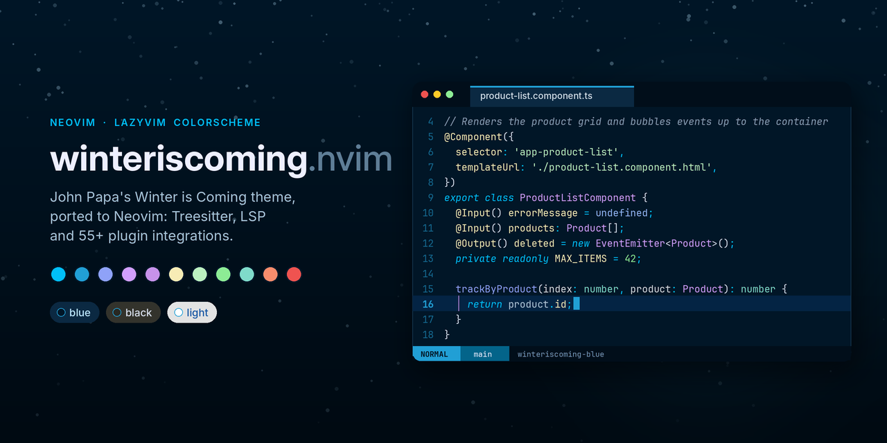

# ❄️ winteriscoming.nvim

[](https://github.com/bytebeast/winteriscoming.nvim/actions/workflows/ci.yml)
[](https://github.com/bytebeast/winteriscoming.nvim/tags)
[](https://neovim.io)
[](https://www.lazyvim.org)
[](https://www.lua.org)
[](LICENSE)
[](https://github.com/bytebeast/winteriscoming.nvim/stargazers)

A Neovim and LazyVim port of John Papa's
[Winter is Coming](https://github.com/johnpapa/vscode-winteriscoming) VS Code



## Styles

| Colorscheme            | Based on                      | Background                   |
| ---------------------- | ----------------------------- | ---------------------------- |
| `winteriscoming-blue`  | Winter is Coming (Dark Blue)  | `#011627` navy               |
| `winteriscoming-black` | Winter is Coming (Dark Black) | `#282822` charcoal           |
| `winteriscoming-light` | Winter is Coming (Light)      | `#ffffff`                    |
| `winteriscoming`       | follows `vim.o.background`    | your `style` / `light_style` |

Comments and keywords are italic by default. The original theme also italicizes
functions, variables, properties and decorators; see [Italics](#italics) to turn
that back on.

## Install with LazyVim

Create `~/.config/nvim/lua/plugins/winteriscoming.lua`:

```lua
return {
  {
    "bytebeast/winteriscoming.nvim", -- or: dir = "~/code/winteriscoming.nvim"
    lazy = false,
    priority = 1000,
    opts = {},
  },
  {
    "LazyVim/LazyVim",
    opts = { colorscheme = "winteriscoming" }, -- or "winteriscoming-black", ...
  },
}
```

LazyVim's lualine uses `theme = "auto"`, which picks up the bundled lualine
theme by itself. The bufferline gets the VS Code tab look (dark inactive tabs, a
lighter navy active tab with a winter-blue marker) without any setup.
Integrations are enabled for exactly the plugins lazy.nvim has installed, so
there is nothing to list. Full docs: `:h winteriscoming`.

Without LazyVim:

```lua
require("winteriscoming").setup({ style = "blue" })
vim.cmd.colorscheme("winteriscoming")
```

## Configuration

These are the defaults; pass only what you want to change.

```lua
require("winteriscoming").setup({
  style = "blue", -- "blue", "black" or "light"
  light_style = "light", -- used when 'background' is light
  transparent = false, -- don't set the editor background
  terminal_colors = true, -- colors for :terminal
  italics = true, -- false drops every italic, comments and keywords included
  bold = true, -- false drops every bold attribute
  styles = {
    -- any attr-list accepted by nvim_set_hl
    comments = { italic = true },
    keywords = { italic = true },
    functions = {},
    variables = {},
    properties = {},
    attributes = {}, -- decorators, tag attributes
    parameters = {},
    types = {},
    strings = {},
    operators = {},
    sidebars = "dark", -- "dark", "transparent" or "normal"
    floats = "dark", -- "dark", "transparent" or "normal"
  },
  bright_line_numbers = false, -- true = every line number in winter blue, like VS Code
  faithful = false, -- true = exact VS Code colors instead of this port's adjustments
  dim_inactive = false, -- darken inactive windows
  lualine_bold = false, -- bold mode section in lualine
  on_colors = function(colors) end,
  on_highlights = function(highlights, colors) end,
  cache = true,
  plugins = {
    all = package.loaded.lazy == nil, -- everything when not using lazy.nvim
    auto = true, -- with lazy.nvim, only plugins you have installed
    -- telescope = true, -- force an integration on or off
  },
})
```

### Italics

To match the VS Code theme exactly, with code italicized as well:

```lua
opts = {
  styles = {
    functions = { italic = true },
    variables = { italic = true },
    properties = { italic = true },
    attributes = { italic = true },
  },
}
```

### Adjusted colors and `faithful`

A few colors are tuned for a terminal, where the original relied on italics to
tell blues apart. `faithful = true` restores the exact VS Code values.

| Role                 | This port | VS Code            | Why                                               |
| -------------------- | --------- | ------------------ | ------------------------------------------------- |
| functions            | `#8fa2f8` | `#87aff4`          | was nearly identical to constants                 |
| variables            | `#b3c8d9` | `#a4ceee`          | greyer, so it separates from keywords             |
| constants            | `#a170c6` | `#82aaff`          | VS Code's own `constant` purple                   |
| comments             | `#8a9db3` | `#999999`          | cool grey-blue at the same contrast               |
| docstrings           | `#a3c7ba` | `#bcf0c0` (string) | long docstrings read as prose, not a wall of mint |
| Dark Black selection | `#2a4258` | `#103362`          | navy turned muddy on charcoal                     |

With an LSP that sends semantic tokens (vtsls in LazyVim), declared class fields
are white and accessed properties cream, as in VS Code, and globals such as
`console` use the library teal.

### Overriding colors

Highlight groups refer to _roles_ (`colors.syntax.keyword`) that point at
_palette names_ (`ice`). Roles are resolved after `on_colors`, so changing a
palette color recolors everything that uses it:

```lua
opts = {
  on_colors = function(c)
    c.ice = "#38c6ff" -- keywords, operators, jump labels, picker matches
    c.syntax.string = "#c3f5c6" -- or change one role only
    c.syntax.func = "frost" -- or point a role at another palette name
  end,
  on_highlights = function(hl, c)
    hl.CursorLineNr = { fg = c.cream, bold = true }
    hl.LineNr = { fg = c.fg_muted }
  end,
}
```

Use the palette elsewhere (statusline components, etc.):

```lua
local colors = require("winteriscoming").colors() -- or .colors({ style = "light" })
```

## Palette

Everything comes from the VS Code theme unless noted. Neovim needs more than an
editor theme does (diff backgrounds, search, jump labels, an orange), so the
palette is expanded with shades derived from the original:

| Name                     | Blue / Black | Light            | Used for                               |
| ------------------------ | ------------ | ---------------- | -------------------------------------- |
| `ice`                    | `#00bff9`    | `#0784a6`        | keywords, operators, `this`            |
| `blue`                   | `#219fd5`    | `#2f86d2`        | cursor, line numbers, statusline, info |
| `periwinkle` / `magenta` | `#8fa2f8`    | `#b1108e`        | functions                              |
| `mist`                   | `#b3c8d9`    | `#6b6b6b`        | variables                              |
| `violet`                 | `#a170c6`    | —                | constants                              |
| `lavender`               | `#d29ffc`    | `#7c2cbd`        | types, classes                         |
| `cream`                  | `#f7ecb5`    | `#b05f0a`        | properties, decorators, current search |
| `mint`                   | `#bcf0c0`    | `#a44185` (plum) | strings                                |
| `green`                  | `#8dec95`    | `#07805e`        | numbers, booleans                      |
| `teal`                   | `#7fdbca`    | `#2f7d70`        | built-in types, hints                  |
| `purple`                 | `#c792ea`    | `#7b30d0`        | active indent guide, storage           |
| `ember`                  | `#f78c6c`    | `#da5221`        | _added_: the orange Neovim UIs expect  |
| `red`                    | `#ef5350`    | `#de3d3b`        | errors                                 |
| `amber`                  | `#ffca28`    | `#9a6a00`        | warnings                               |

The light palette darkens a few original colors slightly (marked `[adj]` in
`lua/winteriscoming/colors/light.lua`) so code stays readable on white.

## Plugin integrations

aerial, alpha, avante, blink.cmp, bufferline, codecompanion, copilot, dashboard,
diffview, fidget, flash, fzf-lua, gitsigns, grug-far, harpoon, headlines,
indent-blankline, lazy.nvim, leap, lspsaga, mason, mini (animate, clue,
cursorword, diff, files, hipatterns, icons, indentscope, jump, pick, starter,
statusline, surround, tabline), neo-tree, neogit, neotest, noice, nvim-cmp,
nvim-dap, nvim-dap-ui, nvim-navic, nvim-notify, nvim-tree,
nvim-treesitter-context, nvim-ufo, oil, rainbow-delimiters, render-markdown,
sidekick, snacks (dashboard, picker, notifier, indent, input…), telescope,
todo-comments, trouble, vim-illuminate, which-key, yanky.

## Extras

Matching themes for other tools are in [`extras/`](extras): alacritty, bat,
delta, fzf, ghostty, iTerm2, kitty, lazygit, tmux, Windows Terminal and wezterm.
Each file starts with install instructions; delta uses the bat theme for its
syntax colors. Regenerate them after changing the palette:

```sh
nvim --headless --clean -u NONE --cmd "set rtp^=." -l lua/winteriscoming/extra/init.lua
```

## Development

```sh
nvim --headless --clean -u NONE --cmd "set rtp^=." -l tests/smoke.lua
```

The smoke test loads all three styles with every integration, checks every link
target and color value, background switching, `italics = false`, `faithful`,
transparency, the cache, overrides and the lualine themes. CI runs it on Neovim
stable and nightly, checks formatting with StyLua, and fails if the generated
extras are out of date. Types for lua-language-server live in
`lua/winteriscoming/types.lua`.

## 🙏 Credits

winteriscoming.nvim stands on the shoulders of:

- **[John Papa](https://github.com/johnpapa)**, creator of
  [Winter is Coming](https://github.com/johnpapa/vscode-winteriscoming) for
  VS Code. The palette is his; this port only adds the extra shades Neovim
  needs and nudges a few colors (see
  [Adjusted colors](#adjusted-colors-and-faithful)).
- **[Sarah Drasner](https://github.com/sdras)**:
  [Night Owl](https://github.com/sdras/night-owl-vscode-theme), whose deep
  navy inspired the Dark Blue background, and the source of the orange this
  port adds.
- **[folke](https://github.com/folke)**:
  [tokyonight.nvim](https://github.com/folke/tokyonight.nvim), whose
  architecture (plugin auto-detection, caching, extras) this plugin follows.
- **[Catppuccin](https://github.com/catppuccin)**:
  [catppuccin/nvim](https://github.com/catppuccin/nvim), the reference for
  integration breadth and the `italics` / `bold` switches.
